# PetCare 🐾
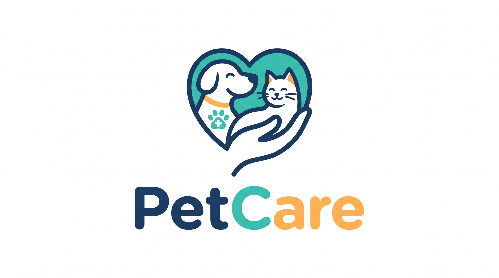
## Descripción del proyecto 
> ------
PetCare es un sistema de gestión para una clínica veterinaria, desarrollado en Java mediante el paradigma de Programación Orientada a Objetos (POO). Su propósito es apoyar la administración de las actividades principales de la clínica, permitiendo registrar dueños y mascotas, gestionar veterinarios y consultorios, programar y atender citas, almacenar información clínica y registrar los cobros de los servicios brindados.

El sistema busca organizar la información relacionada con cada mascota y facilitar el seguimiento de sus consultas, así como el control de las citas y los ingresos generados por los servicios veterinarios.

## Tecnologías utilizadas
> ------
- **Lenguaje de programación:** Java.
- **Entorno de desarrollo (IDE):** IntelliJ IDEA.
- **Modelado UML:** PlantUML.
- **Ejecución:** Aplicación de consola.
- **Almacenamiento:** Los datos se mantienen en colecciones durante la ejecución del programa; esta versión no utiliza una base de datos ni conserva los registros al cerrar la aplicación.

## Modelo de la solución
> ------
El diseño de PetCare se organiza en clases que representan las personas, las mascotas, las citas, la información clínica y los servicios de la clínica. Las responsabilidades se distribuyen entre el paquete `modelo`, que contiene las entidades principales; `servicio`, que administra operaciones y reglas del sistema; y `app`, que contiene el punto de entrada y la interacción con el usuario.

### Diagrama de clases
> -------
**Diagrama del modelo de negocio**

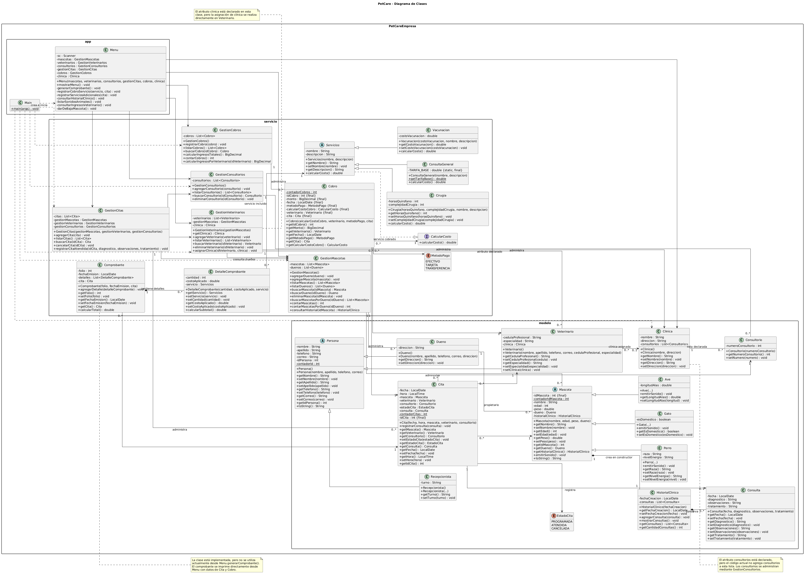

### Decisiones de diseño
> ------
**Herencia**

Se utilizó herencia para representar elementos que comparten características. La clase abstracta `Persona` concentra los datos generales de una persona, como nombre, apellido, teléfono y correo. De ella heredan `Dueno`, `Veterinario` y `Recepcionista`.

También se utilizó la clase abstracta `Mascota` como base para `Perro`, `Gato` y `Ave`. De esta manera, las clases específicas reutilizan los atributos y comportamientos comunes, pero pueden implementar su propio sonido.

Por otra parte, `Servicios` es una clase abstracta de la que heredan `ConsultaGeneral`, `Vacunacion` y `Cirugia`.

**Clases abstractas**

Las clases `Persona`, `Mascota` y `Servicios` son abstractas porque representan conceptos generales y sirven como base para clases más específicas. Por ejemplo, no se necesita crear una mascota genérica, sino una instancia de `Perro`, `Gato` o `Ave`.

**Interfaz**

La interfaz `CalcularCosto` declara el método `calcularCosto()`. La clase `Servicios` la implementa para que los distintos servicios puedan proporcionar su propio cálculo. Además, `Cobro` recibe una referencia de tipo `CalcularCosto`, por lo que puede trabajar con diferentes objetos que implementen esa operación sin depender de una clase concreta.

**Polimorfismo**

El polimorfismo se observa cuando el sistema recorre una colección de objetos de tipo `Mascota` y ejecuta `emitirSonido()`. Aunque todos se manejan mediante la clase base, cada objeto ejecuta la implementación correspondiente a su tipo: perro, gato o ave.

También se aplica al calcular el costo de los servicios mediante la interfaz `CalcularCosto`.

**Composición**

Se utiliza composición entre `Mascota` e `HistorialClinico`. Cada objeto `Mascota` crea su propio historial clínico dentro de su constructor. Por lo tanto, el historial se inicializa como parte de la creación de la mascota y representa un componente de ella.

**Asociaciones**

Una mascota mantiene una referencia a su dueño, mientras que una cita mantiene referencias a la mascota, el veterinario y el consultorio correspondientes. Estas relaciones se modelan como asociaciones porque los objetos relacionados existen y se administran de manera independiente.

## Estructura del proyecto
> ------
La estructura principal del código fuente es la siguiente:

```text
PetCare/
└── src/
    └── PetCareEmpresa/
        ├── app/
        │   ├── Main.java
        │   └── Menu.java
        │
        ├── modelo/
        │   ├── Ave.java
        │   ├── Cita.java
        │   ├── Clinica.java
        │   ├── Consulta.java
        │   ├── Consultorio.java
        │   ├── Dueno.java
        │   ├── EstadoCita.java
        │   ├── Gato.java
        │   ├── HistorialClinico.java
        │   ├── Mascota.java
        │   ├── Perro.java
        │   ├── Persona.java
        │   ├── Recepcionista.java
        │   └── Veterinario.java
        │
        └── servicio/
            ├── CalcularCosto.java
            ├── Cirugia.java
            ├── Cobro.java
            ├── Comprobante.java
            ├── ConsultaGeneral.java
            ├── DetalleComprobante.java
            ├── GestionCitas.java
            ├── GestionCobros.java
            ├── GestionConsultorios.java
            ├── GestionMascotas.java
            ├── GestionVeterinarios.java
            ├── MetodoPago.java
            ├── Servicios.java
            └── Vacunacion.java
```

### Propósito de los paquetes
> ------
- **`app`:** contiene la clase `Main`, que inicializa los objetos necesarios para ejecutar el sistema, y la clase `Menu`, que permite al usuario interactuar con las funciones disponibles.
- **`modelo`:** contiene las clases que representan las entidades principales de la clínica, como personas, mascotas, citas, consultas, consultorios y clínica.
- **`servicio`:** contiene las clases encargadas de administrar las operaciones del sistema, como el registro de citas, mascotas, veterinarios, consultorios y cobros. También incluye los tipos de servicios veterinarios y la interfaz para calcular sus costos.

## Conceptos de Programación Orientada a Objetos aplicados
> ------
Las siguientes referencias indican archivos y líneas donde se pueden observar los conceptos principales. Los números de línea corresponden a la versión del código revisada para este README.

| Concepto | Archivo | Líneas | Aplicación |
|---|---|---:|---|
| Encapsulamiento | `modelo/Persona.java` | 4–10 | Los atributos se declaran privados y se accede a ellos mediante métodos públicos. |
| Herencia | `modelo/Persona.java` | 4; `modelo/Dueno.java`, `Veterinario.java`, `Recepcionista.java` | Las clases específicas heredan los datos y comportamientos generales de `Persona`. |
| Herencia | `modelo/Mascota.java` | 7; `modelo/Perro.java`, `Gato.java`, `Ave.java` | Los tipos de mascota reutilizan la estructura común de `Mascota`. |
| Clase abstracta | `modelo/Persona.java` | 4 | Define una base común para los distintos tipos de persona. |
| Clase abstracta | `modelo/Mascota.java` | 7, 82 | Define atributos comunes y obliga a implementar `emitirSonido()`. |
| Clase abstracta | `servicio/Servicios.java` | 5, 32 | Define la estructura general de los servicios y el cálculo de su costo. |
| Interfaz | `servicio/CalcularCosto.java` | 4–5 | Declara el método `calcularCosto()`. |
| Implementación de interfaz | `servicio/Servicios.java` | 5 | La clase abstracta implementa `CalcularCosto`. |
| Polimorfismo | `modelo/Perro.java`, `Gato.java`, `Ave.java` | 13–18, según el archivo | Cada tipo de mascota sobrescribe `emitirSonido()`. |
| Polimorfismo | `app/Menu.java` | 529–537 | El menú invoca `emitirSonido()` sobre referencias de tipo `Mascota`. |
| Polimorfismo | `servicio/Cobro.java` | 18, 23–32 | El cobro utiliza una referencia de tipo `CalcularCosto` para obtener el importe. |
| Sobrecarga de constructores | `modelo/Persona.java` | 13–18, 22–29 | La clase cuenta con un constructor vacío y otro que recibe los datos de la persona. |
| Composición | `modelo/Mascota.java` | 14, 17–24 | Cada mascota crea e inicializa su propio `HistorialClinico`. |
| Asociación | `modelo/Cita.java` | 11–18, 22–27 | Una cita mantiene referencias a la mascota, el veterinario y el consultorio relacionados. |
| Manejo de excepciones | `servicio/GestionCitas.java` | 34–50, 78–83 | Se lanzan excepciones cuando se detectan conflictos de horario o estados de cita no permitidos. |
| Validación de datos | `modelo/Mascota.java` | 33–37, 46–63 | Se validan el nombre, la edad y el peso de la mascota. |

> En esta versión se identifica sobrecarga de constructores en `Persona`; no se identificó sobrecarga de métodos. Las clases `Comprobante` y `DetalleComprobante` están definidas en el proyecto, pero la opción actual de generar el comprobante imprime la información directamente desde `Menu`.

## Instalación y ejecución
> ------
### Requisitos previos
> ------
- Tener instalado **Java Development Kit (JDK) 24**.
- Tener Git instalado.
- Contar con una terminal, como PowerShell en Windows.

Para comprobar que Java y el compilador están disponibles, ejecuta:

```powershell
java -version
javac -version
```

### Clonar el repositorio
> ------
Sustituye `<URL-DEL-REPOSITORIO>` por la dirección HTTPS del repositorio de PetCare en GitHub:

```powershell
git clone <URL-DEL-REPOSITORIO>
```

Entra en la carpeta del proyecto:

```powershell
cd <NOMBRE-DEL-REPOSITORIO>
```

### Compilar el proyecto
> ------
Desde la carpeta raíz del proyecto, ejecuta en PowerShell:

```powershell
javac -d out (Get-ChildItem -Path .\src -Recurse -Filter *.java | ForEach-Object { $_.FullName })
```

Este comando compila los archivos `.java` y coloca los archivos `.class` generados dentro de la carpeta `out`.

### Ejecutar el programa
> ------
Después de compilar correctamente, inicia la aplicación con:

```powershell
java -cp out PetCareEmpresa.app.Main
```

El menú principal de PetCare aparecerá en la consola y permitirá seleccionar las operaciones disponibles.

## Ejemplo de uso
> ------
El siguiente escenario muestra un recorrido de demostración utilizando las funciones principales del sistema:

1. Registrar 3 dueños y 3 mascotas (Perro, Gato y Ave).
   > Dueño con un perro
   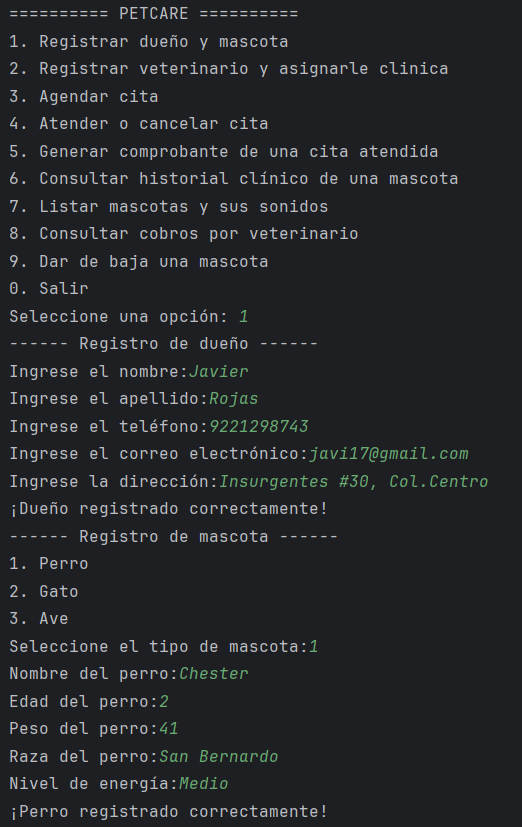
   > Dueño con un gato
   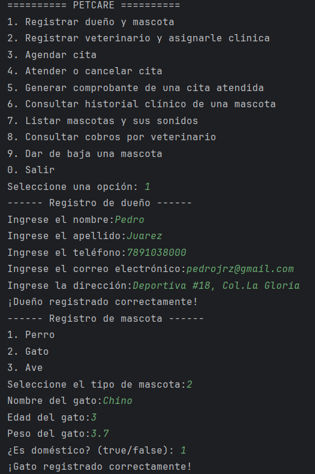
   > Dueño con un ave
   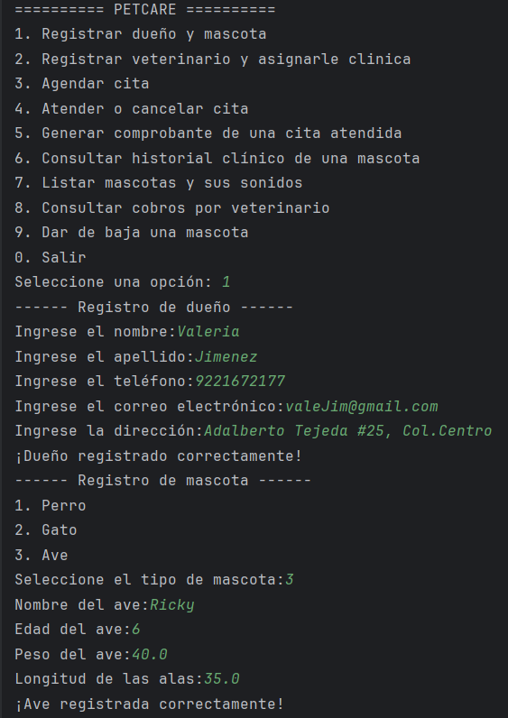
2. Registrar dos veterinarios.
   > Veterinario 1 (Adrian Perez)
   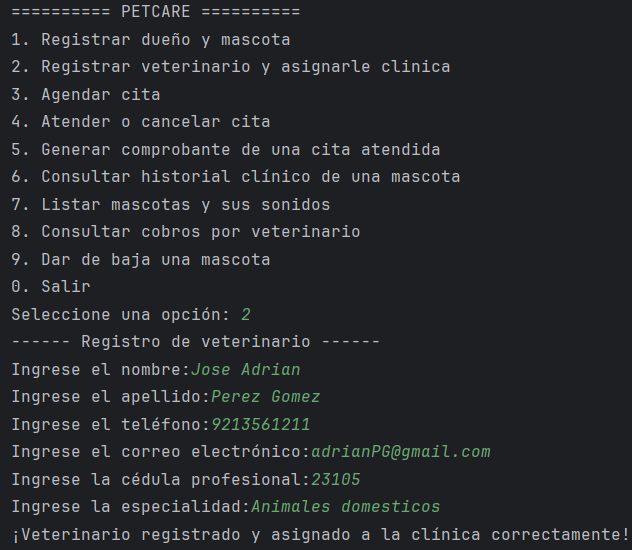
   > Veterinario 2 (Dulce Velázquez)
   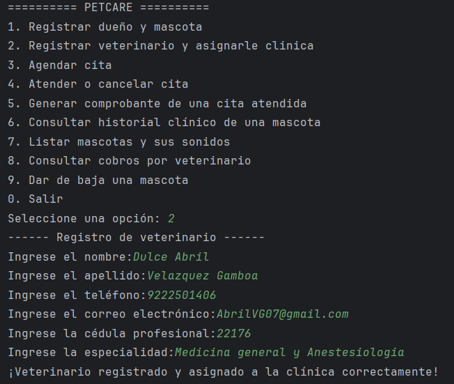
3. Agendar 3 citas y atender 2.
   > Primera cita creada
   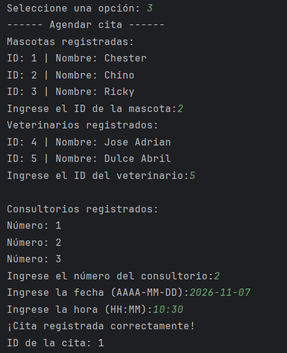
   > Segunda cita creada
   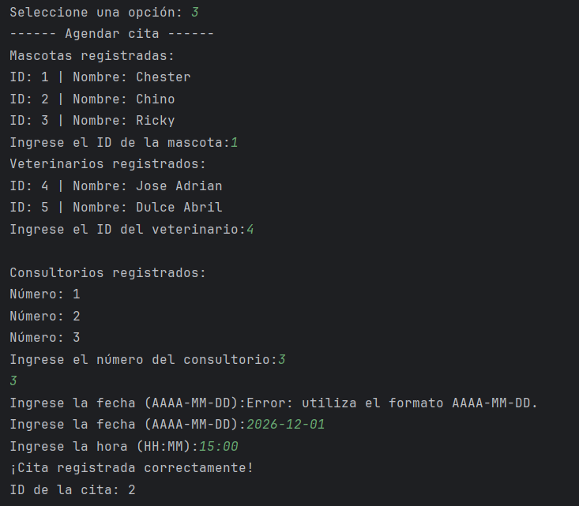
   > Tercera cita creada
   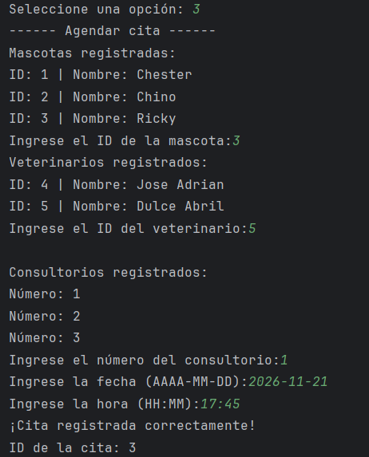
   > Primera cita atendida
   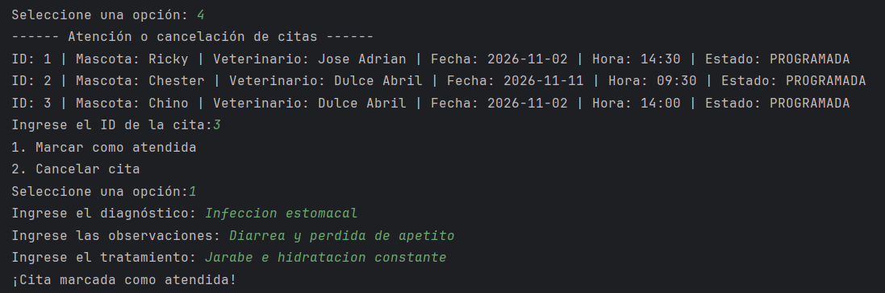
   > Segunda cita atendida
   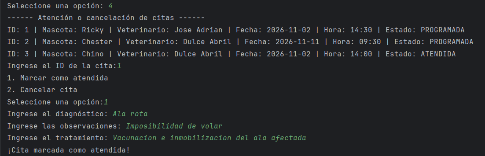
4. Agendar una cita que viole una regla de negocio.
   > No se demostró por limitación de tiempo.
5. Listar mascotas existentes y sus sonidos.
   > Mascotas registradas con sus sonidos
   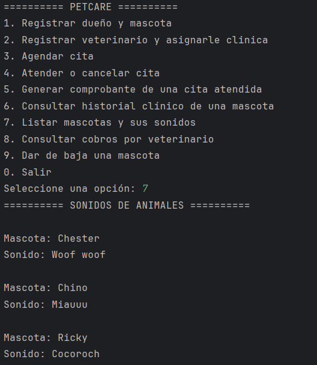
6. Mostrar el total cobrado de una consulta y consultar un historial clinico.
   > Total cobrado de una consulta
   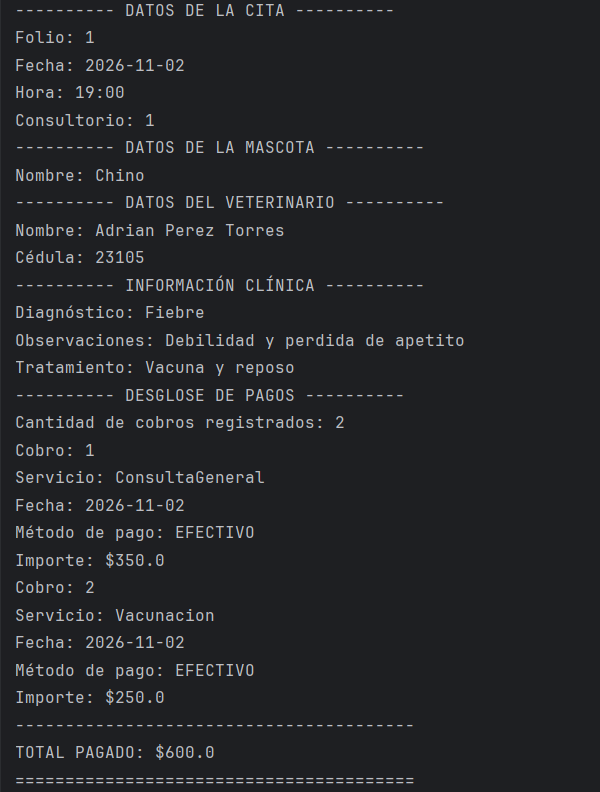
   > Historial clinico de una mascota
   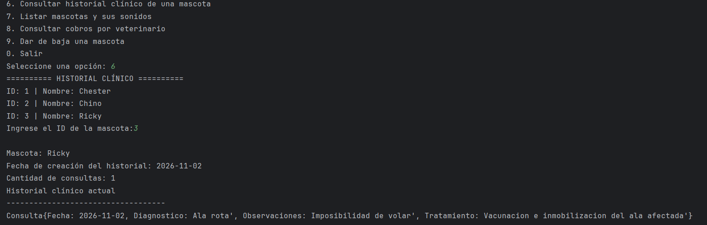
## Reglas de negocio
> ------
Las reglas de negocio establecen las condiciones que deben cumplirse para mantener la coherencia de la información y evitar operaciones incorrectas.

| N.º | Regla de negocio | Archivo y ubicación | Estado en el código revisado                                                                                                                                                                                                         |
|---:|---|---|--------------------------------------------------------------------------------------------------------------------------------------------------------------------------------------------------------------------------------------|
| 1 | El peso y la edad de una mascota no pueden ser negativos ni cero. | `modelo/Mascota.java`, líneas 46–63. | **Parcial.** El peso debe ser mayor que cero, pero la edad solo rechaza valores negativos; actualmente permite registrar una edad de cero.                                                                                           |
| 2 | Un veterinario no puede tener dos citas programadas a la misma hora. | `servicio/GestionCitas.java`, líneas 34–42. | **Implementada.** Se comprueba que coincidan el veterinario, la fecha y la hora con otra cita que siga programada.                                                                                                                   |
| 3 | Una cita cancelada no puede marcarse como atendida. | `servicio/GestionCitas.java`, líneas 78–83; `modelo/Cita.java`, líneas 41–52. | **Implementada.** Solo se permite atender citas cuyo estado sea `PROGRAMADA`.                                                                                                                                                        |
| 4 | Un consultorio no puede usarse en dos citas al mismo tiempo. | `servicio/GestionCitas.java`, líneas 44–50. | **Implementada.** Se verifica que no exista otra cita programada en el mismo consultorio, fecha y hora.                                                                                                                              |
| 5 | Los costos nunca pueden ser negativos. | `servicio/Cobro.java`, líneas 28–32; `servicio/Vacunacion.java`, líneas 18–22; `servicio/DetalleComprobante.java`, líneas 40–44. | **Implementada para los cobros y validaciones indicadas.** El constructor de `Cobro` rechaza costos no finitos, iguales a cero o negativos.                                                                                          |
| 6 | Todo cobro debe poder consultarse por mascota y por veterinario. | `servicio/Cobro.java`, líneas 18–20, 23–27 y 47–64; `servicio/GestionCobros.java`, líneas 62–70; `app/Menu.java`, líneas 540–562. | **Parcial.** Se puede calcular el ingreso por veterinario. Cada cobro conserva una referencia a su cita, desde la cual se puede obtener la mascota, pero no se incorporó una operación específica para consultar cobros por mascota. |

## Reflexión
> ------
### ¿Qué aprendí?

Durante el desarrollo de PetCare reforcé mis conocimientos de Programación Orientada a Objetos en Java. Aprendí a organizar un proyecto mediante paquetes y clases, establecer relaciones entre objetos y aplicar conceptos como herencia, abstracción, encapsulamiento, interfaces y polimorfismo. También practiqué el uso de colecciones, enumeraciones, excepciones y clases para trabajar con fechas y horas.

### ¿Qué fue lo más difícil?

Una de las partes más difíciles fue diseñar las relaciones entre las clases y decidir qué responsabilidades debía tener cada una. También fue un reto coordinar el registro y la atención de las citas, así como validar que no existieran conflictos de horarios y que los cobros estuvieran relacionados con los servicios correspondientes.

### ¿Qué mejoraría?

Durante el desarrollo de este proyecto presenté dificultades para la realización en cuanto a tiempo disponible, implementé lo que me permitió el tiempo. A futuro quisiera implementar más manejos de excepciones e implementar una interfaz gráfica como mis conocimientos los permitan.

### ¿Cómo utilicé la inteligencia artificial?

Utilicé herramientas de inteligencia artificial como apoyo durante el desarrollo para resolver dudas sobre el proyecto, analizar errores, revisar relaciones entre clases y mejorar la documentación. Las sugerencias se utilizaron como orientación y se revisaron en función de mis conocimientos y de las necesidades que quería plasmar en el proyecto.

## Autor
> ------
**Jorge Otilio Salazar Díaz**

GitHub: [Jorge-SDI](https://github.com/Jorge-SDI)